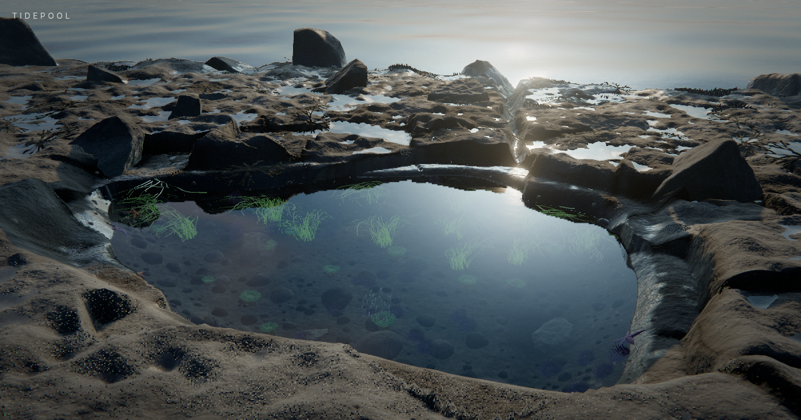

# Tidepool

A basalt rock pool on an exposed Pacific shore, rendered live in the browser: water, light, tide and the animals that live there.

**Open it:** https://adolfolayme.github.io/tidepool/



## What you can do

- Drag to look around, scroll or pinch to move closer.
- Tap the water to make ripples.
- Tap an animal (anemones, the ochre sea star, the hermit crab, sculpins, the shoal of young perch) to look closer.
- Move the **Light** slider from night to dawn, noon and sunset, and the **Tide** slider from low to high.

It picks a quality tier for your device on its own. You can force one with `?q=low`, `?q=medium` or `?q=high`.

## Run it locally

```
pnpm install
pnpm dev
```

`pnpm build` writes a single self-contained `dist/index.html` (textures and sounds are inlined), and `pnpm test` runs the tests.

## How it is made

three.js with its official addons (sky, GPU computation for the ripples, post-processing), anime.js for the close-up camera moves, and TypeScript with Vite. The rock, animals, algae, water, caustics and foam are generated in code; the only files are two CC0 rock textures and two short CC0 sounds. Details in [CREDITS.md](CREDITS.md).

## License

Code under the MIT license. Third-party assets keep their own licenses, listed in [CREDITS.md](CREDITS.md).
